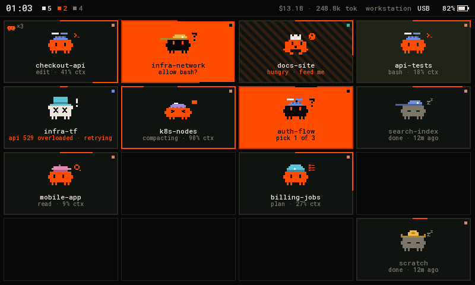
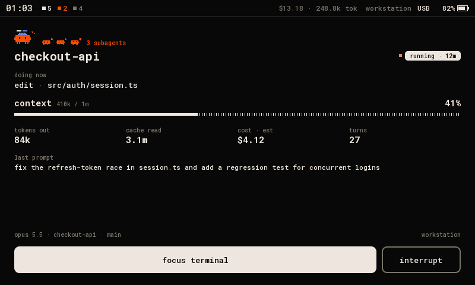
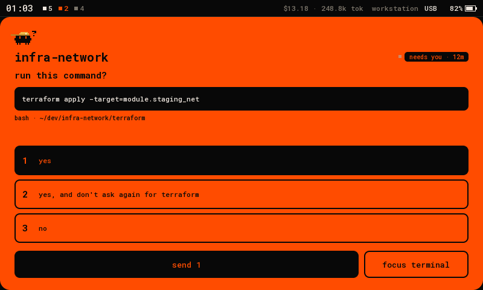
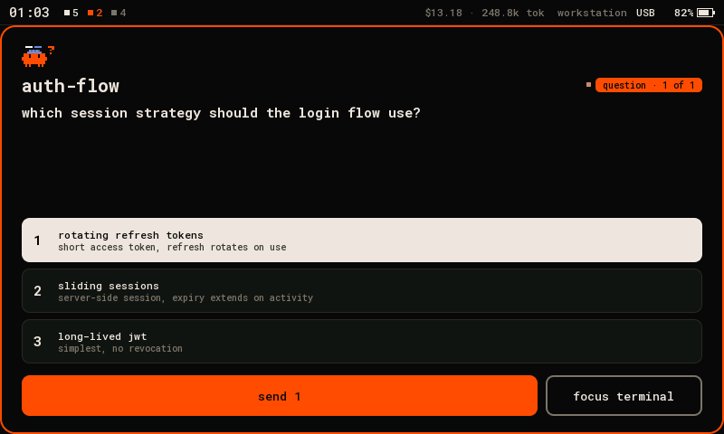
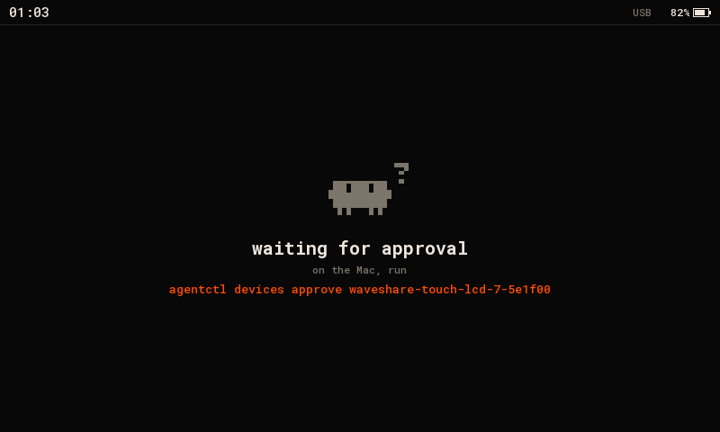
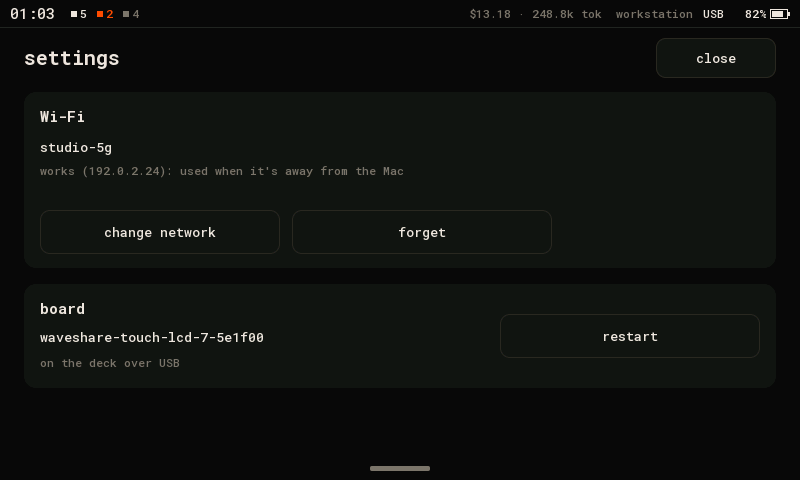
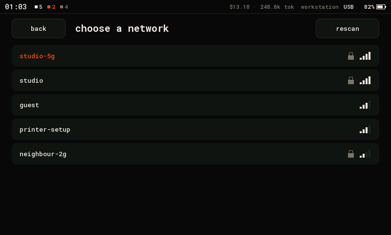
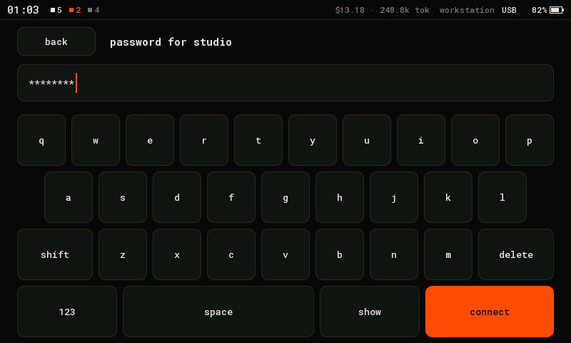
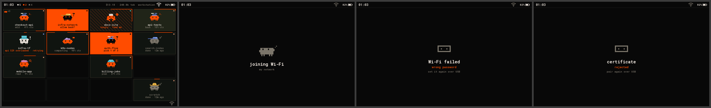

# waveshare-touch-lcd-7: the deck on a 7″ touch panel

The deck's 4×4 board on a [Waveshare ESP32-S3-Touch-LCD-7](https://www.waveshare.com/wiki/ESP32-S3-Touch-LCD-7)
(800×480 ST7262 LCD, GT911 touch), over USB or Wi-Fi with [Deck Link](../../../docs/link/protocol.md). It looks
like the desk panel and the web board, stretched across a wide screen.

> **Tested on one board:** the picture, touch, the status bar, Deck Link over the UART port and
> choosing a network in the settings, on the `idf5` build. Not tested yet: reaching the deck over
> Wi-Fi, and the 2.0.17 build. If the picture is wrong on yours, see [Bring-up](#bring-up).

| grid | card | permission | question | approval |
|---|---|---|---|---|
|  |  |  |  |  |

(Rendered on the host from `docs/fixtures/state.json` by `firmware/panel-core/tools/render_docs.sh`.
Every screen is in `docs/`.)

It uses the same layout as the [4″ board](../waveshare-touch-lcd-4/README.md): the desk panel's
Flutter UI at 2/3 of its size (`layout_big.h`). The screen is as tall as the 4″ board's, so every
size is the same. The grid's cells grow wider to fill the 800 px (`specBig800()`).

- **Status bar.** Across the top of every screen, like a phone's (`status_bar.h`):
  - on the left, the time and how many agents are working, need you (orange), or neither;
  - on the right, the cost and output tokens of the agents on the deck, the machine it's
    connected to, USB or the Wi-Fi mark, and the battery (see below).

  The deck sends the time in UTC, so the board needs its time zone. Build with
  `PANEL_TZ`, a POSIX TZ string; without it the clock shows UTC:

  ```sh
  PLATFORMIO_BUILD_FLAGS='-DPANEL_TZ=\"CET-1CEST,M3.5.0,M10.5.0/3\"' pio run -d firmware/devices/waveshare-touch-lcd-7/idf5 -e idf5 -t upload
  ```
- **Settings.** Pull the status bar down (or tap it) for the board's settings, like a phone's:
  - **Wi-Fi:** the saved network and how it's doing (connected, its address and signal, or what went
    wrong). **Choose network** lists the networks in range, strongest first, with a lock on the ones
    that need a password; tap one, type the password on the on-screen keyboard, and **connect**.
    The board saves it and tries it at once. **Forget** (tap twice) drops it.
  - **Restart** (tap twice).

  Swipe up, or tap **close**, to go back. The settings work whether or not the deck is there, so a
  board whose Wi-Fi fails can be set up again without the Mac. Typing the network on the board needs
  the board in your hand, like the cable: nothing on the network can set it. The board still needs
  pairing over USB once before it can reach the deck over Wi-Fi.

  | settings | networks | password |
  |---|---|---|
  |  |  |  |
- **Battery.** The board charges a single Li-ion cell (PH2.0 connector, CS8501 charger) but doesn't
  wire the cell's voltage to any pin, so out of the box the bar shows no battery. To show it, add a
  divider from the cell to an ADC pin (for example the Sensor AD header) and build with
  `-DLCD7_BAT_ADC=<gpio>` and `-DLCD7_BAT_DIVIDER=<ratio>` (2.0 for two equal resistors). The bar
  then shows the charge, from 3.3 V (empty) to 4.15 V (full).

- **Grid.** The deck's 4×4 board, tiles by slot, paged. Each tile shows:
  - the critter with its pose and hat;
  - the title and a status line;
  - the context along the border;
  - the tool chip;
  - the subagent critter.

  Orange means it needs you. Stripes mean a finished turn you haven't looked at. Swipe or tap the
  page bars to change page.
- **Card.** Tap a tile to see the agent's details:
  - the critter and its subagents;
  - what it's doing now;
  - its context;
  - tokens out, cache read, cost and turns;
  - the last prompt;
  - model, folder and branch.

  The button row underneath: **focus terminal**; **interrupt** while the agent runs; otherwise
  **stop**, which arms on the first tap. Once the agent has exited: resume and remove.
- **Prompts.** One layout for permissions and questions. Tap an option to choose it, then **send**.
- **Back.** Swipe right. The board has no button for the firmware: its BOOT pin (GPIO0) is one of
  the panel's data lines.
- **Backlight.** On or off only: the board can't dim it. It stays on while the deck runs.

## Connect it

The board has two USB-C ports. Use the one marked **UART**: Deck Link runs on UART0, through the
board's CH343 USB-serial chip, at 115200 baud (`ARDUINO_USB_CDC_ON_BOOT=0` in both `platformio.ini`).
Flashing works on the same port, and the CH343 resets the board into the bootloader by itself.
The port marked **USB** (the ESP32-S3's own USB) isn't used.

```sh
pio run -d firmware/devices/waveshare-touch-lcd-7/idf5 -e idf5 -t upload --upload-port /dev/cu.usbmodem<…>
agentctl link add /dev/cu.usbmodem<…>
agentctl devices approve waveshare-touch-lcd-7-<id>      # only with `agentctl devices auto-approve usb off`
agentctl devices scope waveshare-touch-lcd-7-<id> act    # answer, focus, interrupt; admin to stop
```

It subscribes to every agent with all fields (`TILE | CARD | PROMPT | NUMBERS`) and keeps up to 64 in
PSRAM. The Hello says: display 800×480 colour, input TOUCH.

## Build and flash

| env | what |
|---|---|
| `waveshare-touch-lcd-7` (`platformio.ini`) | arduino-esp32 2.0.17: USB only (no TLS 1.3, so no Wi-Fi) |
| `debug` | the same with one-line notes on the USB port |
| `idf5` (`idf5/platformio.ini`) | arduino-esp32 3.x: USB and Wi-Fi (TLS 1.3) |
| `idf5-debug` | `idf5` with notes on the USB port (link, Wi-Fi phase, frame time, memory) |

```sh
pio run -d firmware/devices/waveshare-touch-lcd-7/idf5 -e idf5 -t upload --upload-port /dev/cu.usbmodem<…>
```

| build | RAM | flash |
|---|---|---|
| `waveshare-touch-lcd-7` | 34 KB (10.5%) | 442 KB (13.2%) |
| `idf5` | 77 KB (23.6%) | 1.25 MB (37.4%) |

The board has 8 MB of PSRAM and 8 or 16 MB of flash, depending on the batch (the one this was
written on has 16 MB). It uses arduino-esp32's `default_8MB.csv`, which fits both. The two 800×480 frames (the firmware's and the panel's) take 750 KB each, in PSRAM.

The `idf5` project works as on the other boards: its platform lives in `~/.platformio-pioarduino`,
and the first build rebuilds arduino-esp32's libraries with TLS 1.3. If it fails with `No module
named 'SCons.Tool.FortranCommon'`, see the fix in [the 2.1″ board's README](../waveshare-touch-lcd-21/README.md#wi-fi).

## Wi-Fi

On the `idf5` firmware it works away from the Mac as on the other boards
([the 2.1″ board's README](../waveshare-touch-lcd-21/README.md#wi-fi) has the whole story):

1. **Pair.** Plug it into the Mac. Once it's approved, it pairs by itself.
2. **Give it a network.** Choose one in the settings (pull the status bar down), or let it get the
   deck's default network over USB (`agentctl link wifi --default --ssid "my network"`), or give it
   one of its own (`agentctl link wifi waveshare-touch-lcd-7-<id> --ssid …`).
3. **Unplug it.** Then power it anywhere. Plugged into the Mac again, USB wins at once.



The RGB panel scans straight from PSRAM. If the picture drifts or tears while Wi-Fi is busy, set
`LCD7_BOUNCE_PX` in `idf5/platformio.ini` to 8000 (10 lines). The panel then scans out of a bounce
buffer in internal RAM.

## Hardware

The board has no wiring of its own. Pins below are from Waveshare's BSP and demos for this board:

| part | pins |
|---|---|
| ST7262 RGB | DE 5, VSYNC 3, HSYNC 46, PCLK 7; R 1 2 42 41 40; G 39 0 45 48 47 21; B 14 38 18 17 10 |
| panel timing | 16 MHz, sampled on the falling edge; hsync and vsync: pulse 4, back porch 8, front porch 8 |
| I²C | SDA 8, SCL 9: GT911 touch 0x5D, CH422G IO expander |
| GT911 INT | GPIO4: held low while the touch leaves reset, which gives address 0x5D |
| CH422G | mode at 0x24, outputs at 0x38. EXIO1 touch reset, EXIO2 backlight, EXIO3 LCD reset, EXIO4 SD card CS, EXIO5 USB/CAN select |

## Bring-up

`pio run -e debug -t upload` (or `idf5-debug`) builds the same firmware with one-line notes on the UART
port. The first line says what it found: `lcd7: expander ch422g, gt911 0x5D, framebuffer 0x…`. The
deck ignores these notes.

| you see | try |
|---|---|
| a black screen, `expander NONE` | the I²C pins or the CH422G addresses are wrong: the backlight is on EXIO2 |
| a picture, wrong colours | the R and B lines swapped: swap the R and B pin lists in `src/main.cpp` |
| a picture that rolls or shimmers | the timing: try `pclk_active_neg` 0, or 14 MHz |
| no touch, `gt911 0x00` | the touch didn't leave reset: check EXIO1 and GPIO4 |
| touch in the wrong place | the GT911's resolution or axes: check the raw x, y in `touch()` |

## Code

`src/main.cpp` is only the board: display, touch, expander, backlight. The layout, the touch UI and
Deck Link are shared with the other panels in [`firmware/panel-core`](../../panel-core)
(`layout_big.h`, `specBig800()`).
